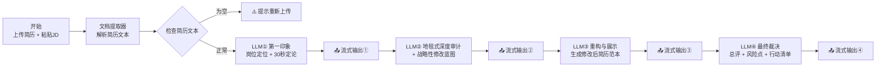

# 大厂产研简历优化教练 · Dify Chatflow

> 上传简历 + 粘贴目标岗位 JD，AI 面试官对简历进行五步走地毯式审查，流式输出「第一印象 → 深度审计 → 修改蓝图 → 重构范本 → 行动清单」的完整优化报告。

基于 **Dify Chatflow** 构建的多阶段 LLM 流水线应用，面向投递大厂产品/技术岗位的求职者，prompt 设计支持**按岗位级别分级批判**，对初级/基础岗位候选人做了专门的口径校准。

## 工作流程



## 核心设计亮点

| 设计 | 说明 |
|---|---|
| **分阶段流式输出** | 4 个 LLM 节点间插入直接回复（Answer）节点，用户无需等待全链路跑完，逐段看到审查进展 |
| **三位一体反馈模型** | 所有问题严格按「❓ 指出问题 → 🤔 负面影响 → 💡 具体方案」格式反馈，拒绝空泛建议 |
| **分级批判 + 初级岗位纠偏** | 按 JD/简历判断目标职级调整标准；针对基础岗位明确「考察基础扎实度与学习潜力，鼓励为主、批判为辅」 |
| **上下文接力设计** | 后续节点通过 `<first_impression>` / `<pre-process_results>` 标签接收前序结论，保证五步判断口径一致 |
| **启发式占位符** | 重构范本时对缺失数据使用 `[量化指标：例如…]` 占位符引导用户补充，杜绝 AI 捏造经历 |
| **健壮性工程** | 空文件 IF/ELSE 兜底分支、LLM 节点失败自动重试 3 次、显式 max_tokens 防长输出截断、上传文件类型白名单 |

## 迭代记录

- **v1**：原始版本——四段 LLM 串行流水线 + 五步走提示词体系
- **v2**：健壮性修复——修复 Step2 节点未接收 Step1 结论的上下文断链；新增空文件兜底分支；文件类型白名单修正为 PDF/DOCX/TXT/MD；补充 max_tokens；LLM 节点开启自动重试
- **v3**：提示词校准——新增「初级/基础岗位纠偏条款」，统一人设措辞，修正输出文案错别字
- **v4**：模型迁移——切换至 DeepSeek V4.1 Flash（100 万 token 上下文），插件依赖升级至 deepseek 0.0.24

## 快速开始

1. Dify（≥ 1.x）中安装 **DeepSeek** 插件（0.0.24），并在「设置 → 模型供应商」中配置 API Key（[platform.deepseek.com](https://platform.deepseek.com) 申请）
2. 「工作室 → 导入 DSL 文件」上传本仓库的 `大厂产研简历优化教练-C-Level.yml`
3. 检查 4 个 LLM 节点模型均为 `DeepSeek V4.1 Flash`，点击「发布」
4. 在对话页上传简历文件（PDF/DOCX/TXT/MD），输入框粘贴目标岗位 JD，开始审查

## 文件说明

```
├── 大厂产研简历优化教练-C-Level.yml   # Dify DSL 导出文件（v4，直接导入即可）
└── README.md
```

## License

MIT
